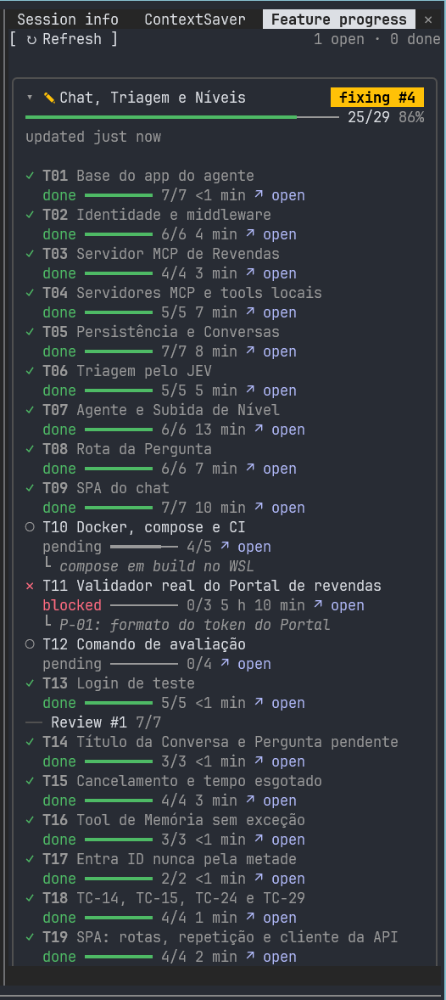
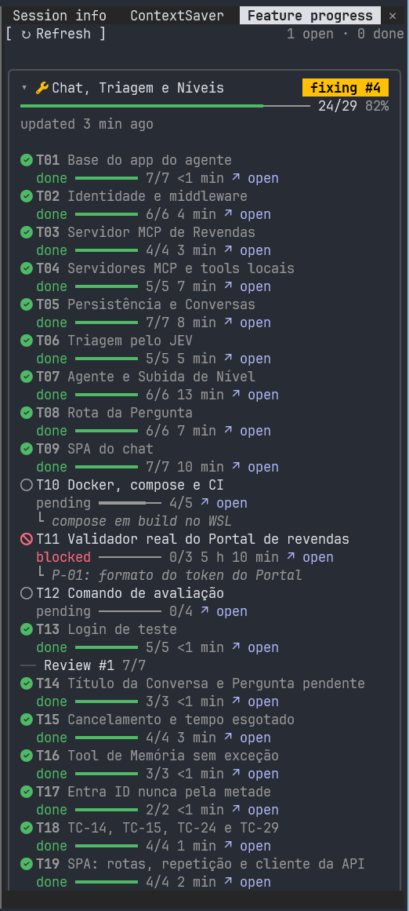
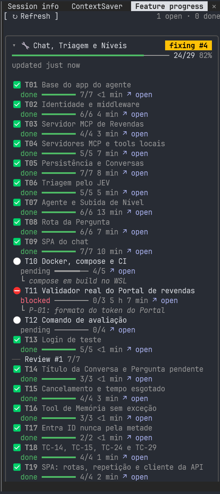

<h1 align="center">📋 feature-progress</h1>

<p align="center">
  A Claude Code mod that shows the progress of a feature and its tasks while a spec-driven flow runs: a band above the prompt with the stage and the count, and a pane with every task.
</p>

<p align="center">
  
  <a href="../LICENSE"></a>
  
</p>

<p align="center">
  <a href="#-install">Install</a> ·
  <a href="#-report-progress-from-your-flow">Report progress</a> ·
  <a href="#-settings">Settings</a> ·
  <a href="#-limitations">Limitations</a> ·
  <a href="#-development">Development</a>
</p>

## ✨ What it does

The mod does not read the files of any flow. It registers 1 tool, `mcp__feature-progress__report`, and the flow calls it at each change of state. Any flow can report: SDD skills, other skills with other artifact names, or a prompt.

- 📍 **Band** above the prompt: the open feature with the latest report, its glyph, its stage as a colored chip, a meter of the done tasks and the count, for example `✎ Checkout  fixing #1  ━━━━━─── 12/17`. A stale feature ends with `⚠ stale`. On a narrow band the meter goes first, then the title shortens. Press the band to open the pane. With no open feature, the band shows nothing. `/feature-progress band` hides or shows it.
- 🗂️ **Pane** (`/feature-progress`): a **↻ Refresh** button and the counts of open and done features, then 1 card per open feature, the latest first and expanded, the others collapsed. A card has a rounded frame that lights in the state's color under the pointer, the stage chip, a meter with the count and the percent, and `updated X ago`. Each task row shows a glyph and a word for its state, the round, a meter for its steps (`━━━━──── 2/5`), how long it ran, an **↗ open** button for its link, and its note under it. The tasks keep the order in which the flow added them. Each group is 1 block, such as `── Review #1 1/3`, at the place of its first task. Done features wait in a collapsed **Done** section. Below 64 columns the details of a task go under its title; below 44 columns the cards lose their frame.
- 💾 **Files:** 1 JSON file per feature in the storage folder (`.claude/feature-progress/` by default). The progress survives `/clear`, `/resume` and a new session, and another session in the same repository sees it after **Refresh**.

Every state has a glyph and a word; the color only adds to them. Nothing animates. Set `paneBackground` to paint the pane body, and `icons` to pick Nerd Font or emoji glyphs.

<p align="center">
  
</p>

<p align="center">
  
  
  
</p>

## 🚀 Install

At the Claude Code prompt:

```text
/plugin install feature-progress --marketplace dougcunha/claude-mods
```

Answer `y` to add the marketplace and choose a scope. If you already added the marketplace:

```text
/plugin install feature-progress@claude-mods
```

Add the storage folder to the repository's `.gitignore`, unless you want the progress files in Git:

```text
.claude/feature-progress/
```

## 📣 Report progress from your flow

Tell the session that runs your flow to call `mcp__feature-progress__report` at each change of state. Only the main session reports; a call from a subagent is answered `Ignored: only the main session reports progress.` and stores nothing. A skill that reports should skip the step when the tool is not there, so the flow also runs without the mod.

### Input

| Field | Type | Required | Rule |
| --- | --- | --- | --- |
| `feature.id` | string | always | Lower case letters, digits and `-`, 1 to 64 characters, such as the slug of the feature folder. It names the file. |
| `feature.title` | string | first call | Not empty. |
| `feature.state` | state | no | One of the 9 states below; a new feature without one is `pending`. |
| `feature.label` | string | no | Shown instead of the state word in the band and the feature chip, for example `Revisão`. `""` clears it. |
| `feature.round` | integer or `null` | no | The review, correction or QA round, 1 or more; shown as `#2`. `null` clears it. |
| `feature.note` | string | no | A short reason or remark. `""` clears it. |
| `tasks[]` | array | no | The tasks that changed, each as below. |
| `tasks[].id` | string | always | 1 to 64 characters, no control character. |
| `tasks[].title` | string | new task | Not empty. |
| `tasks[].state`, `.label`, `.round`, `.note` | | no | As for the feature, except that a task `label` shows next to the state word, for example `review #1 · Revisão`, so the word for the state stays. |
| `tasks[].group` | string | no | The pane groups tasks by it, for example `Review #1`. `""` clears it. |
| `tasks[].steps` | `{ done, total }` or `null` | no | Whole numbers, `total` 1 or more, `done` from 0 to `total`. `null` clears it. |
| `tasks[].link` | string | no | A file path, relative to the session's working folder or absolute. `""` clears it. |
| `remove` | string[] | no | Ids of tasks to delete; an unknown id is ignored. |

### Merge rules

- Each call merges into the stored feature. Send `feature.id` always, `feature.title` on the first call, and only what changed.
- A task is matched by `id`. A new id adds the task at the end of the list; a known id changes only the fields the call sends. One call may not send the same task id twice.
- The mod sets the timestamps: `updatedAt` on every change, `startedAt` the first time a feature or task leaves `pending`, `finishedAt` when it enters `done` (cleared when it leaves `done`). Every report also moves the feature's `updatedAt`.
- The count is `done` tasks out of all tasks, correction tasks included.
- A wrong call is refused with the field to fix, for example `feature-progress: tasks[0].state must be one of: pending, planning, active, review, fixing, qa, waiting, blocked, done`, and nothing is written. A valid call answers the stage and the count, for example `feature-progress: review #2 · 12/17`.

### States

| State | Glyph (`unicode`) | Emoji | Color | Use it for |
| --- | --- | --- | --- | --- |
| `pending` | ○ | ⚪ | `inactive` | Not started |
| `planning` | ◇ | 📝 | `suggestion` | Writing the requirements, the design or the plan |
| `active` | ● | 🚀 | `claude` | Implementing |
| `review` | ◎ | 🔍 | `permission` | In code review, with the review number as `round` |
| `fixing` | ✎ | 🔧 | `warning` | Correcting what a review or QA found, with the round |
| `qa` | ◆ | 🧪 | `merged` | In QA, with the QA run number as `round` |
| `waiting` | ◷ | ⏳ | `planMode` | Waiting on a person, such as an approval |
| `blocked` | ✕ | ⛔ | `error` | Blocked, with the reason as `note` |
| `done` | ✓ | ✅ | `success` | Finished |

The colors are names of the Claude Code theme, so they follow the theme you pick in `/config`. The `nerd` set draws Font Awesome glyphs from a Nerd Font: circle, compass, play, eye, wrench, flask, hourglass, ban and check.

### Examples

The first call creates the feature and its plan:

```json
{
  "feature": { "id": "02-checkout", "title": "Checkout", "state": "active" },
  "tasks": [
    { "id": "T01", "title": "Cart totals", "state": "active", "steps": { "done": 0, "total": 3 }, "link": "tasks/prd-02-checkout/task_01.md" },
    { "id": "T02", "title": "Payment step" }
  ]
}
```

A later call moves 1 task to `done` and starts the next:

```json
{
  "feature": { "id": "02-checkout" },
  "tasks": [
    { "id": "T01", "state": "done", "steps": { "done": 3, "total": 3 } },
    { "id": "T02", "state": "active" }
  ]
}
```

A review round, its correction tasks, and the next stage:

```json
{
  "feature": { "id": "02-checkout", "state": "fixing", "round": 1 },
  "tasks": [{ "id": "T08", "title": "Fix CR-01", "group": "Review #1", "link": "tasks/prd-02-checkout/codereview_01/task_08.md" }]
}
```

### The stored file

`<folder>/<id>.json` holds `schemaVersion` (1), the feature fields, its timestamps and `tasks`. A file the mod cannot read as a feature (broken JSON, another `schemaVersion`, a missing field, or a name that is not `<id>.json`) shows as a warning row in the pane, and a report for that id is refused until you fix or delete the file. A report reads the file before it writes, so it keeps what another session wrote since this session last read the folder.

## 🎮 Use

| Command | What it does |
| --- | --- |
| `/feature-progress` | Opens the pane, or closes it when it is open. |
| `/feature-progress band` | Hides the band, or shows it when it is hidden. It changes the `showBand` setting as `/config` does, so the choice stays after `/clear`, `/resume` and in new sessions. The pane and the reports still work while the band is hidden. |
| `/feature-progress clean` | Deletes the files of every `done` feature in the storage folder, and toasts `Deleted N done features.` The files of open features stay. |

The pane opens at any width when you ask for it. When the terminal is too narrow, a toast says `feature-progress: widen the terminal to open the pane.`

## 🔧 Settings

Set them in `/config`, under the mod's name.

| Option | Default | What it does |
| --- | --- | --- |
| `folder` | `.claude/feature-progress/` | The folder of the feature files, relative to the session's working folder or absolute. Empty uses the default. |
| `staleMinutes` | `30` | Minutes without a report before an open feature shows `⚠ stale`. A `waiting` or `done` feature is never stale. `0` turns the marker off. |
| `editor` | `auto` | The program the **open** button starts: `auto` (VS Code when its `code` command is on the `PATH`, else the system's default program), `vscode`, or `system`. |
| `showBand` | `true` | Shows the band above the prompt. `false` hides it; `/feature-progress band` flips it. |
| `paneBackground` | empty | A color for the body of the pane in the terminal: hex such as `#2e3440`, or a color name. Empty keeps the color Claude Code draws. The frame and the close row keep Claude Code's color, and the desktop app ignores it. |
| `icons` | `unicode` | The glyphs of the states: `unicode` works in every terminal, `nerd` needs a Nerd Font, `emoji` needs a terminal that draws emoji 2 cells wide. |

## 🚧 Limitations

- **No live updates from other sessions:** the API has no file watch, and the mod does not poll. A session sees its own reports at once; another session's reports show after **Refresh**, `/clear`, `/resume` or a new session.
- **The band can be hidden by another mod:** the band draws above what the mods beneath it draw. A mod that draws the band above the prompt without passing it on (savvy-progress does) hides this band when it runs first. The pane still works.
- **Files in the repository:** the mod writes and deletes only `<id>.json` files in the storage folder. This is a documented exception to the repository rule that mods write only to the temporary folder.
- **Delete command:** the mod API has no file delete, so `/feature-progress clean` runs `rm -f -- <id>.json …` (macOS, Linux) or `cmd /d /c del /f /q <id>.json …` (Windows) with the storage folder as the working folder. The ids allow only lower case letters, digits and `-`, so no name carries shell syntax.
- **Links on Windows:** VS Code opens through `cmd /c code`. A link whose path holds `& | < > ^ % ! "` is not opened, because the link comes from the model; a toast says so.
- **Two sessions on one feature:** each report reads, merges and writes the file. Two reports at the same moment can lose one of them; the next report puts the state right.
- **Size:** a feature file stays under 4 MiB; a report that would pass it is refused.
- **Platforms:** tested on Windows 11. The commands for macOS and Linux (`open`, `xdg-open`, `rm`) are covered by unit tests only.

## 🔨 Development

```text
claude plugin validate .
claude plugin test feature-progress
claude --plugin-dir ./feature-progress
```

<details>
<summary>🗂 Source files</summary>

| File | Role |
| --- | --- |
| `hooks/register.tsx` | The tool, the command, the band and the pane; the `session.start`, `session.end`, `tool.call`, `command.run` and `ui.render` hooks |
| `hooks/report.ts` | The tool input narrowing, the merge, `remove` and the timestamps |
| `hooks/store.ts` | The storage folder, the file parser, the 4 MiB guard, loading, and the delete argv |
| `hooks/progress.ts` | Stage text, count, order, groups, stale marker, relative times, the meter share and the percent |
| `hooks/spec.ts` | The tool spec and its description |
| `hooks/band.tsx`, `hooks/pane.tsx` | The band line, and the pane with its cards and task rows |
| `hooks/meter.tsx` | The meter of done cells |
| `hooks/icons.ts` | The glyph of each state per icon set, and its color |
| `hooks/viewer.ts`, `hooks/platform.ts` | Opening a link, and the platform |
| `hooks/settings.ts` | The settings and their defaults |
| `hooks/paths.ts`, `hooks/host.ts` | Path helpers, and the engine calls the helper modules use |
| `types/index.d.ts` | The stored feature types and the `$.state` contract |

</details>

## 📄 License

[MIT](../LICENSE)
