<h1 align="center">🧭 session-info</h1>

<p align="center">
  A Claude Code mod with one pane and thirteen sections.
</p>

<p align="center">
  
  <a href="../LICENSE"></a>
  
</p>

<p align="center">
  <a href="#-install">Install</a> ·
  <a href="#-use">Use</a> ·
  <a href="#-settings">Settings</a> ·
  <a href="#-limitations">Limitations</a> ·
  <a href="#-development">Development</a>
</p>

## ✨ Sections

- 📊 [**Session**](#-what-the-session-section-shows): the context window's fill, compactions and /clear commands, the prompt cache with the time until it expires and a Keep warm button, the session's cost and duration, and turn stats. A [cache guard](#-cache-guard) holds a prompt that would write an expired cache again.
- 🔁 [**Last turn**](#-what-the-last-turn-section-shows): how the last turn ended, how long it took and what it cost, its model, effort and request count, its token and cache counts, the tools it called, and the calls the permission check refused.
- ✅ [**Todos**](#-what-the-todos-section-shows): the task list Claude keeps for work with several steps, like OpenCode's todo list. The mod gives Claude a `todo_write` tool for it, and a switch that keeps Claude working while tasks remain open.
- ⏳ [**Autopick**](#-what-the-autopick-section-shows): a switch that answers a question Claude asked and you left unanswered with the option Claude marked as recommended, after a wait you set. A countdown shows the time left, with Pick now and Cancel. The switch starts off.
- 🧠 [**Skills**](#-what-the-skills-section-shows): the skills the conversation loaded, which agent loaded each one, and the ones still active.
- 🚦 [**CI**](#-what-the-ci-section-shows): the GitHub Actions runs that a push, a pull request, a workflow dispatch or a rerun of the session started, with their jobs, a link and a notification when each run ends.
- 🎫 [**Jira**](#-what-the-jira-section-shows): the Jira issues the chat mentions, with summary, status, priority and assignee, read through the Atlassian MCP server you connected.
- 📈 [**Usage**](#-how-usage-updates): your plan's rate-limit windows as bars, like `/usage`, updated live.
- 🤖 [**Agents**](#-what-the-agents-section-shows): the session's subagents and teammates with their status, model and effort, children under the agent that spawned them.
- 🛰️ [**Background**](#️-what-the-background-section-shows): the shell commands Claude started in the background, such as a dev server or a long build, with their status and how long they ran.
- 🧪 [**Checks**](#-what-the-checks-section-shows): whether the last build and the last test run the session started passed, with the error lines of a failed build or the names of the failed tests, and a prompt that asks Claude to fix a failure, and a switch that skips a build or test run when nothing changed since the same command passed. .NET, Node, Bun, Rust, Go and Python tools are recognized.
- 🌿 [**Git**](#-what-the-git-section-shows): the branch and whether it is on the remote, the working-tree counts, the last commit, a merge or rebase in progress, the submodules that changed, and every file `git status` lists, in a treeview like the Changes one. Pressing a file opens its diff against HEAD; pressing the branch name opens your Git client, such as lazygit, in a new terminal window.
- 📝 [**Changes**](#-how-changes-are-detected): every file the current session created, modified or deleted, in a treeview. Pressing a new file opens it in your editor; pressing a modified or deleted file opens its diff in the diff viewer configured on your machine.

🔔 It also raises a native notification when a usage window reaches 80% or 90%, or the context window reaches 85%, even with the pane closed. See [Alerts](#-alerts).

### 🎨 Cards, tabs and order

Each section is a card with a rounded frame that lights up under the pointer in the fullscreen terminal, and a row of tiles above them shows the cost and the elapsed time at a glance. Bars fill in whole cells, so the line after the filled run starts flush against it in every bar. In a terminal pane narrower than 44 columns the frames and tiles step aside and the sections draw bare, as in earlier versions. The desktop app always draws the frames and tiles, sizing them and the bars by percentage instead of terminal cells.

Sections can share one card as tabs, to make the pane shorter. By default Changes and Git do: the card opens on Changes, and pressing a tab shows that section in the same place. A tab that is not active shows a count, such as `Changes 12`, so a hidden section still says it has something. The `tabGroups` option sets the groups, for example `changes+git, ci+jira+skills`.

The `sectionOrder` option sets the order of the sections, top to bottom, for example `changes, git, session`. The sections it does not name follow in the default order: Session, Last turn, Todos, Skills, CI, Jira, Usage, Agents, Background, Checks, Git, Changes. A tab group card sits where its first shown section sits in this order, and it stays there when you press another tab. The order of the tabs in the card, and the tab it opens on, come from `tabGroups`. For example, with `sectionOrder` set to `git, session` and the default group `changes+git`, the Changes and Git card is at the top and opens on Changes. A group typed whole, such as `changes+git`, also counts as its sections in order.

### 🔍 Reading a text that a row cuts

A row that does not fit the pane ends in `…`. Pressing a cut text opens the whole of it in place of the sections, with a **← Back** button (`b`) that returns to them and a **Copy** button (`y`) that puts the text on the clipboard. The text is wrapped to the pane and scrolls with it. These texts open that way:

| Section | Texts |
| --- | --- |
| Last turn | The tools called and the refused calls |
| Autopick | The recommended options of a question that waits, the `Picked` line (why it happened, then each pick on its own line) and the warning about the ask-autopick mod |
| CI | The error that stopped the polling |
| Jira | An issue's summary and the error of a failed read |
| Agents | An agent's model, effort and task description |
| Background | A command's name and its whole command, every line of it |
| Checks | The command, the result line and the error lines or failed test names, shown together |
| Git | The commit subject and the operation in progress |

The view keeps the first 4,000 characters of a text. It is not saved: `/clear` closes it, and so does a reload.

## 📸 Screenshot

The pane in a fullscreen terminal at the start of a task: an autopick countdown on a question, a task list with its first task in progress, and an active skill:

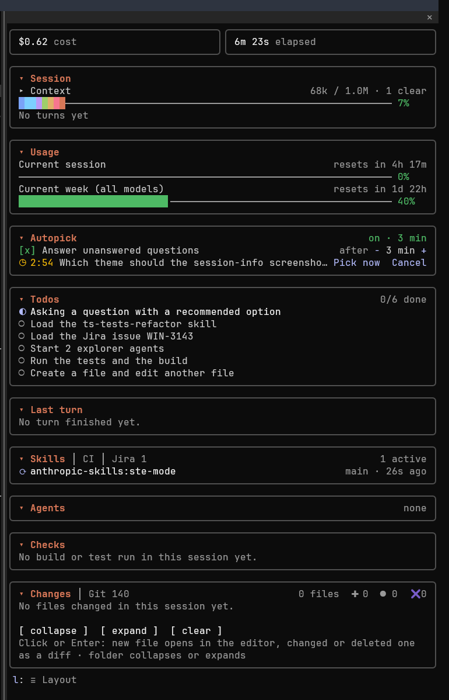

Each section that follows has its own screenshot from the same session.

## 🚀 Install

At the Claude Code prompt:

```text
/plugin install session-info --marketplace dougcunha/claude-mods
```

Answer `y` to add the marketplace and choose a scope. If you already added the marketplace:

```text
/plugin install session-info@claude-mods
```

## 🎮 Use

| Action | How |
| --- | --- |
| Open the pane | `/session-info` (or `/changes`). To open it when the session starts, set `session-info.openOnStart` to `true` |
| Fold or unfold a section | Press its header, for example `▾ Session` or `▾ Changes` |
| Open the Git client | Press the branch name in the `▾ Git` header, or press `g` while the pane has the focus |
| Show the legend of the context bar | Press `▸ Context` |
| Keep the prompt cache warm, or stop | Press `Keep warm` or `Stop` on the cache row of the Session section |
| Send a prompt the cache guard held | Press Enter again, or press `Compact` or `New session` on the band above the prompt |
| Open a file | Click the file in the fullscreen terminal, or move to it with Tab or the arrow keys and press Enter. A new file (`A`, or `??` in the Git tree) opens in the editor; a modified (`M`) or deleted (`D`) file opens as a diff. In the Git tree, the diff is against HEAD |
| Collapse or expand a folder | Press the folder |
| Scroll a long tree | A tree taller than the room the terminal leaves draws a window of rows with a scrollbar (`┃` on the track `│`) at its right edge, and under it `▲` and `▼` with the rows above and below. Press `▲` or `▼`, or `u` and `d`, to move a page; press the track to jump to that place. The wheel over a list moves that list, a page at most per turn of the wheel; elsewhere on a pane taller than its window it scrolls the whole pane, and so does the wheel over a list that has reached its end. A list always shows at least 6 rows. The arrow keys move the first tree on screen while the pane fits its window. In the Git tree `u` and `d` work while the Changes tree is not on screen |
| Collapse all, expand all, clear the list | `c`, `e`, `x`, or the buttons at the bottom. The Git tree has collapse and expand only; `c` and `e` go to it while the Changes tree is not on screen |
| Turn autopick on or off | Press `[ ] Answer unanswered questions` in the Autopick section, or run `/autopick on` or `/autopick off` |
| Set the autopick wait | Press `−` or `+` in the Autopick section, or run `/autopick <minutes>`, 1 to 120 |
| Answer a waiting question now, or stop its countdown | Press `Pick now` or `Cancel` on its row in the Autopick section |
| Move or hide a card | Press `≡ Layout` at the bottom of the pane, or press `l` while the pane has the focus. Each card header then shows `↑`, `↓` and `✕`. Press `≡ Done` or `l` again to leave layout mode. See [Arrange the cards](#-arrange-the-cards) |
| Show a hidden card again | Press its name after `Hidden:` at the bottom of the pane, or press `[ ]` before its name in the `Sections` list of layout mode |
| Return to the prompt | `Esc` |

Status colors follow your theme: green for created (`A`), yellow for modified (`M`), red and struck through for deleted (`D`). Chains of single-child folders collapse into one row, for example `src/app/ui`.

## 📊 What the Session section shows

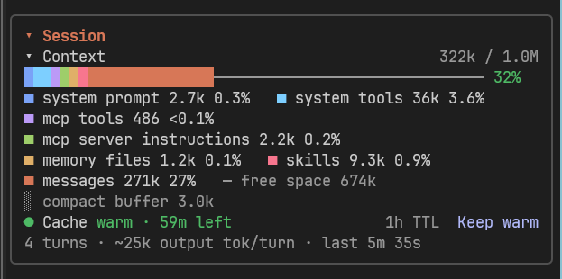

| Row | Source |
| --- | --- |
| Cost and elapsed (tiles) | The session's cost as `/cost` totals it and the time since the session started. In a narrow pane, they move to the section header |
| Context bar | The live context window: tokens used, the window size, where auto-compaction runs (`compacts at 967k`) and the percentage. The bar is stacked, one color per category (system prompt, tools, memory files, skills, messages), then the free space as a thin line and the compaction buffer shaded. Pressing `▸ Context` unfolds a legend with each category's tokens and share. The categories are estimated locally after each turn and compaction; before the first reading the bar has one color |
| Compactions | Compactions that went through in the main conversation |
| Clears | `/clear` commands run since the mod loaded, by hand or by another mod (`· 3 clears`); it shows after the first reply that follows a `/clear` |
| Cache | The prompt cache of the main conversation: the state in its color on the left, `● Cache warm · 42m left`, `◐ Cache cools in 3m` in bold in the last 5 minutes (the last minute of a 5-minute TTL), `○ Cache cold for 12m` in bold, or `◆ Cache kept warm · 3h 55m left` while [keep warm](#-keep-warm) runs; and the details on the right, dim: the TTL, `next prompt re-caches 412k` when cold, the pings of keep warm, and `2 re-caches (380k)`, which counts the requests that wrote most of the context to the cache again. Before the first reply it shows the TTL alone |
| Turns | Main-thread turns, their average output tokens, and how long the last one took |

The compaction and clear counts start when the mod loads, so a newly installed mod starts them at zero. When the mod joins a conversation that already has turns, after a resume or an install, the turn count starts from the prompts in its transcript.

After a `/clear` or a `/resume` in the same process, Claude Code starts the next conversation with empty pane state and raises no start event for it. The mod waits until the session id changes, then reads the context, the repository, the Autopick switch and the Jira server again and, on a resume, the task list from the transcript.

### ⏱ How the cache time is found

Each request of the main conversation reads the cache, writes it, or both. The mod notes when the last one ended and how much context it sent. The cache expires one TTL after that request.

The TTL comes from these sources, the first one that applies:

1. The `cacheTtl` setting, when you set `5m` or `1h`.
2. The TTL Claude Code reports when you switch the model.
3. The session's own requests. A request that writes most of a 30k+ context to the cache again after 5.5 to 60 idle minutes shows a 5-minute TTL. A request that reads most of it from the cache after more than 5.5 idle minutes shows a 1-hour TTL.
4. The account: 1 hour when Claude Code reports plan rate limits, 5 minutes on an API key. The first reply of a session keeps 1 hour, because the limits can come after it.

A switch to another model starts the cache over, so the row waits for the next reply. After a reload or an install in a session with a finished turn, the mod dates the cache from the end of that turn until the next request. The first request after a compaction writes the shorter context and does not count as a re-cache.

### ✋ Cache guard

When the cache expired and the context has at least `cacheGuardMinTokens` tokens (150k by default), the prompt you type does not go in. Claude Code puts it back in the prompt box, and a band above the prompt shows how long ago the cache expired and how many tokens the prompt would write to the cache again:

- **Enter** sends the prompt here, as typed.
- **Compact** runs `/compact`. The prompt stays in the box, and Enter sends it over the shorter context.
- **New session** runs `/clear` and leaves the prompt in the box of the new session.

The mod never sends the prompt for you, so it goes in as your own, with its images and `@` mentions. The guard checks only a prompt you type at an idle session: slash commands, prompts typed during a turn and prompts from Remote Control, a plugin or a background task go in at once. Set `cacheGuard` to `false` to turn it off.

### 🔥 Keep warm

`Keep warm` on the cache row sends one small request shortly before the cache expires, so the cache lives a full TTL again. The request forks the conversation as the main thread last sent it, with the text `session-info keep-warm ping. Reply with only: ok`; its reply is thrown away. Each ping costs a cache read of the whole context, about a tenth of a write. Keep warm runs for `keepWarmHours` (4 by default) and stops by itself when:

- a ping writes to the cache instead of reading it, or gets no answer;
- the cache had already expired;
- the time runs out.

A toast says why it stopped. `/clear` stops it too.

## 🔁 What the Last turn section shows

The section shows the last turn of the main conversation. It updates when the turn ends.

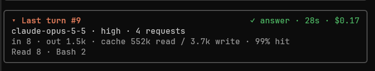

| Row | Source |
| --- | --- |
| Header | The turn's number (`#14`), how the turn ended (`✓ answer`, `⊘ aborted`, `✖ refusal`, `✖ error`), its duration, and its cost: the session's cost when the turn ended minus the cost when it started, so it includes the subagents that ran during the turn |
| Model | The model of the last request of the turn, the effort it sent, and how many model requests the turn made |
| Tokens | Input, output, cache read and cache write tokens, summed over the turn's requests, and the share of the input that the prompt cache served (`cache read / (input + cache read + cache write)`) |
| Tools | The tools the main conversation called in the turn, most-called first, four names and then `+N more`. An MCP tool shows by its own name. Then the subagents the turn spawned and the tokens of the subagent runs that ended during the turn |
| Refused | The calls of the main conversation that the permission check refused in the turn (`⊘ 2 refused: Bash (Bash(rm:*)) · WebFetch (mode)`), in order, four and then `+N more`. Each names what decided: the settings rule as written, the hook (`PreToolUse`), the setting, or `mode` for the permission mode. The row shows only when a call was refused |

The token counts of the main turn do not include its subagents; the Tools row shows them apart. The Refused row reads the verdict that Claude Code's rules, permission mode and hooks give before a call runs. A call that you refuse in the permission dialog, or that the auto-mode classifier refuses, is not in it: the mod gets no verdict for those. A subagent that runs in the background and ends after the turn is not counted. When the mod loads while a turn runs, for example after a reload, that turn's record has no effort, request count, tools or cost. `/clear` empties the section.

## 🤖 What the Agents section shows

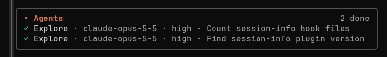

Every agent loop of the session, as Claude Code lists it: subagents the model or a plugin spawned and teammates. Each row shows a status glyph, the agent's name (or its type), its model and effort, and its task description:

| Glyph | Status |
| --- | --- |
| `⟳` | running |
| `⏸` | waiting |
| `◌` | pending |
| `○` | idle (a teammate waiting for a message) |
| `✓` | completed |
| `✖` | failed |
| `⊘` | killed |

Active agents come first; an agent spawned by another is indented under it. Claude Code drops a finished agent from its list some time after it ends, and the row leaves with it. The section redraws when an agent starts or finishes a turn, and once a minute. Up to 8 rows are shown.

The model comes from the agent's spawn and then from each of its model requests; the effort comes from its requests only, so it shows after the agent's first request. The last request wins, so a fallback model shows too. An agent that started before the mod loaded shows its model and effort after its next request; one that ended before that shows neither. `/clear` forgets them.

## 🛰️ What the Background section shows

The shell commands that Claude started with `run_in_background`, in a `Bash` or `PowerShell` call of the main conversation or of a subagent. Each row shows a status glyph, the task's name, and its state in words with the time it has run or ran for:

| Glyph | State | Meaning |
| --- | --- | --- |
| `⟳` | `running · 3m 2s` | The command runs, and the time counts up |
| `✓` | `done · 12s` | The task ended with the status `completed` |
| `✖` | `failed · 4s` | The task ended with any other status than `completed` or `killed` |
| `⊘` | `stopped · 1m 1s` | The task was killed, or Claude stopped it with `TaskStop` |
| `•` | `ended · 2m 5s` | Claude Code no longer lists the task as running, and no notification gave its status |

The name is the description Claude wrote for the call, with the command on a dim line under it; with no description, the command's first line is the name (the detail view shows the whole command). Running tasks come first, then the ended ones, newest first. The header counts them by state, and a tab that is not active shows how many run. Up to 8 rows are shown, then a count of the rest, and the section keeps the last 30 commands.

A command is `running` until its task notification reaches the session: Claude Code sends one when a background task ends, and the mod marks the task ended then, not at the moment the command exits. The mod reads the notification from the session's message queue, so a notification that lands in a running turn, or goes to a subagent, ends the task too. The time of an ended task is the time the notification took to arrive.

A task that Claude stops with `TaskStop` sends no notification, so the mod marks it `stopped` when the call succeeds. A task that ends in another way with no notification, for example one you stop from the tasks dialog, stays `running` until the end of the next turn: the mod then compares the list with the background tasks that Claude Code reports as in flight, and marks each task that is not there `ended`. A notification that arrives later replaces `ended` with the real status. A foreground command is not listed, and neither is a task that Claude Code started without a shell call, such as a background subagent (the Agents section has those). The section keeps only the command, the description and the state: it never keeps a command's output. `/clear` empties it. Commands that the Checks section recognizes as a build or test run show in both sections.

## 🧪 What the Checks section shows

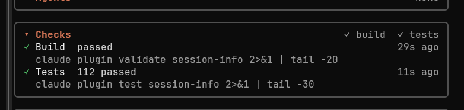

One row for the last build and one for the last test run, from any shell command the session ran, a subagent's included (marked `agent`). A command counts when one of its segments runs a known tool, so `cd app && npm test` and `rtk dotnet test …` count too. The runners in front of a tool and their options are skipped: `rtk`, `env`, `time`, `npx`/`bunx`/`uvx` (so `npx -y -p typescript tsc` is `tsc`), `pnpm`/`yarn exec` and `dlx`, `uv`/`poetry`/`pipenv`/`hatch run`, `bundle exec` and variable assignments such as `CI=1`.

<details>
<summary>📋 Recognized build and test commands</summary>

| Check | Commands |
| --- | --- |
| Build | `dotnet build`, `dotnet publish`, `dotnet pack`, `dotnet msbuild`, `msbuild`, `npm`/`pnpm`/`yarn`/`bun run build`, `compile`, `typecheck` or `type-check`, `bun build`, `tsc`, `vue-tsc`, `tsgo`, `tsup`, `esbuild`, `webpack`, `rollup`, `vite`/`next`/`nuxt`/`astro`/`ng`/`parcel`/`turbo`/`nx`/`flutter build`, `claude plugin validate`, `cargo build`, `cargo check`, `cargo clippy`, `go build`, `go vet`, Gradle and Maven builds, `swift`/`zig`/`stack`/`cabal build`, `mix compile`, `xcodebuild`, `cmake --build`, `ninja`, and `make` alone or with `all` or `build` |
| Tests | `dotnet test`, `dotnet run` of a test project, `npm`/`pnpm`/`yarn`/`bun test`, `bun test`, `jest`, `vitest`, `mocha`, `ava`, `playwright test`, `cypress run`, `node --test`, `deno test`, `claude plugin test`, `turbo`/`nx test`, `cargo test`, `cargo nextest`, `go test`, `gotestsum`, `pytest`, `python -m unittest`, `tox`, `nox`, Gradle and Maven `test`, `check` or `verify`, `rspec`, `rake test`, `rails test`, `phpunit`, `pest`, `php artisan test`, `mix`/`swift`/`flutter`/`dart`/`stack`/`cabal test`, `zig build test`, `ctest`, `make test` and `make check` |

</details>

> [!TIP]
> Add your own commands, such as `./build.ps1`, with the `buildPattern` and `testPattern` settings.

The status comes from the command's exit code; an interrupted or timed-out command shows as failed. When a pipe hid the exit code (`dotnet test | tail -3`), the summary in the output decides. The details come from the output itself:

| Check | Shows |
| --- | --- |
| A failed build | The error count and the first error lines (`file(line,col): code: message`). With no recognizable error line, the last lines of the output |
| A test run | `12 passed`, or `2 failed / 120` with the first failed test names. A test run that did not compile shows the compile errors |
| A command run in the background | `running in background` until its task ends. Claude Code then sends the session a notification with the task's status and output file; the mod reads that file and shows the result as for a command in the foreground |

The output is read as the model got it: raw, filtered by RTK, or localized. Localized .NET output (`Com falha! – Com falha: 2, Aprovado: 1, …`) is read by its structure, not its words. When RTK cut the output and points to the whole log (`[full output: …]`), or wrote a vitest JSON report in its place, the mod reads that file for the counts and names.

The readers were checked against real output of `dotnet build` and `dotnet test` (VSTest and Microsoft.Testing.Platform, English and Portuguese), tsc, jest, vitest, `node --test`, Bun and `cargo test`, each with and without RTK. Go and pytest are read by their documented formats. For the other tools, the status comes from the exit code, and the counts and failed names show when the output has a format the mod already reads, such as `claude plugin test`, which prints Bun's.

### 💡 Fix suggestion

When a turn of the main conversation ends and the last build or test run failed, the mod proposes a prompt in the empty prompt box, dim, for Tab to take:

| Failure | Prompt |
| --- | --- |
| Build with an error count | `Fix the 2 build errors` |
| Build without an error count | `Fix the failed build` |
| Test run with failed test names | `Fix the 2 failed tests: Subtract_Fails, Divide_Throws`, three names and then `and N more` |
| Test run without names | `Fix the 3 failed tests`, or `Fix the failed test run` |

A failed build comes first, because a build that fails often explains the failed tests. Each failed run gets one proposal: the next turn proposes again only for a new failed run. Until you send the next prompt, the proposal replaces the suggestion that Claude Code makes after a turn. Claude Code shows no proposal while the prompt box holds text. Set `suggestFix` to `false` to turn it off.

### ↺ Build guard

The **Skip unchanged builds and tests** switch, the last row of the section, stops Claude from running the same build or test command again when nothing changed. It starts off; the mod keeps its state in `$.store`, so it stays as you left it in every window and session.

While it is on, each shell command that the section recognizes as a build or test run, in the foreground, gets a fingerprint first: the folder, the command, HEAD, the diff of every tracked change (tracked changes inside submodules included) and the content of every untracked file that `.gitignore` does not hide. The `rtk` wrapper is left out of the command, so `rtk dotnet build` and `dotnet build` share a fingerprint; variable assignments such as `PORT=1` stay in it.

| Situation | What happens |
| --- | --- |
| The same command passed on the same fingerprint less than 30 minutes ago | The command does not run. Claude reads a short output in its place: the result of the earlier run, and how to run it anyway |
| Anything else | The command runs as usual. A run where every check passed is kept under its fingerprint; a failed run forgets it |
| The command ends in `# rerun` | The command runs even when it is unchanged. `#` starts a comment in bash and in PowerShell, so the shell ignores it |
| Outside a git repository, on a repository without commits, with more than 200 untracked files, or when git fails or cuts its output | The command runs; the guard does not keep it |

Build output lives in ignored folders (`bin/`, `obj/`, `dist/`, `node_modules/`), so a build leaves the fingerprint as it was. A run that writes tracked or untracked files, such as a lock file, changes the next fingerprint, and the next run goes through. The 30 minutes cover what the fingerprint cannot see: a database, a service or an environment variable that a test reads.

Under the build and test rows, each of the last three skips has a row, `↺ Build skipped, same as 4m 2s earlier`; pressing it shows the command and the text Claude read. The switch is the last row of the section, and beside it the section counts what the skips saved, such as `3 skipped · 2m 5s · ~800 tokens`: the duration of each skipped run as it took the last time, and the output Claude did not read, at about four characters per token.

The fingerprint runs four or five git commands, only for the commands the section recognizes and only while the switch is on. The skips and the kept runs belong to the conversation: `/clear` empties them.

## 🌿 What the Git section shows

The section shows the repository of the session's folder and only what differs from a clean state. A row with nothing to say is left out, so a clean repository takes one row under the header.

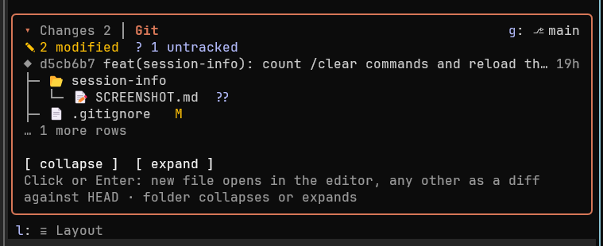

```text
▾ Git                                   g: ⎇ main ↑2 ↓1
  ⚠ Rebase in progress: step 3 of 7
  ✖ 1 conflict  ● 2 staged  ✎ 3 modified  ? 1 untracked
  ◆ a1b2c3d feat: add the Git section               12m
  ◇ 4 submodules · 2 changed
    libs/core  new commit · modified
    libs/ui  not initialized
  ├─ ▾ src
  │  ├─ ● a.ts  M
  │  ├─ ● b.ts   M
  │  ├─ ✚ new.ts  A
  │  └─ ● merge.ts  UU
  └─ ✚ notes.md  ??

  [ collapse ]  [ expand ]
```

| Row | Shows |
| --- | --- |
| Header | The branch, then `↑` commits ahead of and `↓` commits behind its upstream. `local only` when the branch has no upstream, `upstream gone` when the upstream was deleted on the remote, `detached` and the short hash on a detached HEAD |
| Operation | A merge, rebase (with its step), cherry-pick, revert or bisect that stopped halfway |
| Counts | Conflicts, staged, modified and untracked files, the non-zero ones only. Each untracked file counts, also inside a new folder. Submodules are not counted here |
| Last commit | Short hash, subject and age |
| Submodules | The submodule count, then one row per submodule that is in conflict, not initialized, on a commit other than the one the repository records (`new commit`), or with changed files (`modified`). Up to 5 rows. Only the submodules of the repository itself are listed; a change in a nested submodule shows as `modified` on its parent |
| Files | Every changed, staged and untracked file, in a treeview from the repository root, with the code of `git status --short`: the staged letter in green, the unstaged letter in yellow, `??` for an untracked file and a red pair such as `UU` for a conflict. Up to 500 files. Pressing a new file opens it in the editor; pressing any other file opens its diff against HEAD (for a rename, against the old path at HEAD) in the configured diff viewer |

The mod reads the repository when the session starts, after each shell command or file edit, when you send a prompt, when you open the pane, and once a minute. It runs `git status --porcelain=v2 --branch --untracked-files=all`, `git log -1`, and `git submodule status` when the repository has a `.gitmodules` file. It never runs `git fetch`, so `↑` and `↓` compare with the last fetch.

### 💻 Git client

Pressing the branch name, or `g`, opens the `gitClient` command (default `lazygit`) in a new terminal window, in the repository root:

| System | Window |
| --- | --- |
| Windows | `start`, which opens the default terminal app: Windows Terminal on Windows 11 |
| macOS | Terminal.app |
| Linux | The first of `x-terminal-emulator`, `gnome-terminal`, `konsole`, `xfce4-terminal`, `kitty`, `alacritty`, `wezterm`, `foot` and `xterm` found on the `PATH`. `sh` changes to the repository root before it starts the client |

> [!NOTE]
> A toast tells you when the command is not on the `PATH`. The mod looks for it with `where` on Windows and `command -v` on macOS and Linux. Set `gitClient` to empty to make the branch name plain text.

## 🔔 Alerts

The mod notifies once per threshold through your Claude Code notification channel (`preferredNotifChannel`):

| When | Notification |
| --- | --- |
| A usage window reaches 80%, then 90% | `Current session at 82% · resets in 1h 10m` |
| The context window reaches 85% | `Context at 86% (172k / 200k): compaction is near` |

A usage window alerts again after it resets; the context alert re-arms once the context drops under 85%, for example after a compaction. When notifications are off or the terminal has no channel, the alert shows as a toast instead. Turn alerts off with the `alerts` setting.

## 📈 How usage updates

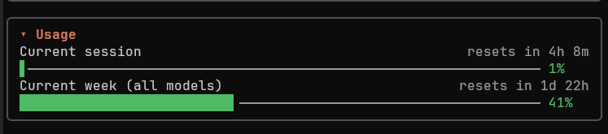

The bars read the same figures as `/usage` and the status line. Claude Code learns them from each API response, so they move after a reply, not while the session is idle. The pane redraws when a window moves a whole point, and once a minute so the reset countdown stays current.

The section shows each window Claude Code reports: the current session (`five_hour`), the current week (`seven_day`) and a gateway's spend limit. A bar and its percentage are green below 50%, yellow from 50%, orange from 70% and red from 90%. The single-color context bar uses the same scale. On API-key or other non-subscription accounts there are no windows to show.

## 📂 How a file opens

A **new file** opens in your editor. With the `auto` editor that is VS Code when `code` is on the `PATH`, else the app the system associates with the file (`explorer.exe` on Windows, `open` on macOS, `xdg-open` on Linux). Terminal editors such as `$EDITOR` cannot open from the pane.

A **modified or deleted file** opens as a diff. A deleted file whose previous content is unknown (outside git and never captured) opens nothing.

The diff compares the file **as it was before the session first touched it** with the file as it is now, not with `HEAD`. The original content is saved under `%TEMP%` (or `$TMPDIR`) in `claude-session-info/<session id>/`.

With the `auto` viewer, the mod opens the first of these that is available:

1. **git's GUI diff tool**: `git difftool --gui --no-index`, when `diff.guitool` or `merge.guitool` is set. For example, for Beyond Compare:
   ```text
   git config --global diff.guitool bc
   ```
2. **VS Code**: `code --diff`, when `code` is on the `PATH`.
3. **Inline**: the unified diff drawn inside the pane.

## ✅ What the Todos section shows

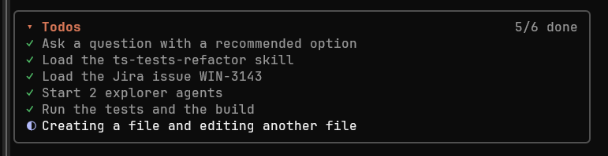

Claude Code gives the model no task tool in every setup, so the mod registers its own: `todo_write`, which the model sees as `mcp__session-info__todo_write`. A short section at the end of the system prompt tells the model to write a list for work with 3 or more steps and to update it as each task starts and ends. Each call sends the whole list and replaces the previous one.

| Glyph | Status |
| --- | --- |
| `○` | Pending |
| `◐` | In progress, drawn bold with the running form of the task (`Writing the section`) |
| `✓` | Completed, drawn dim |
| `⊘` | Cancelled, drawn dim and struck through |

The header counts the completed tasks out of the tasks not cancelled. The section draws 12 tasks and folds the rest into `… N more`. Only the main conversation keeps the list: a subagent's call changes nothing. A resumed session takes the list back from the last call in its transcript.

Claude still decides when to write a list: the prompt section only asks for one. Two settings shape what it asks, so the rule lives with the tool instead of in a CLAUDE.md that would keep it after the mod is off:

- `todoMinSteps`: the step count that calls for a list, 3 by default. With 1, the section asks for a list for any work, but not for a question that needs only an answer.
- `todoInstruction`: your own text for the section, in place of the built-in one, under the `# Task list` heading. Empty keeps the built-in text.

The tool and the prompt section use tokens on each request. Set `showTodos` to `false` to remove both, with the section.

The list belongs to the conversation: `/clear` empties it, a new session starts without one, and `/reload-plugins` keeps it.

### ⏩ Auto-continue

The **Continue while tasks remain** switch, the last row of the section, keeps Claude working when it ends a turn with tasks still open, so you do not have to type `continue`. It starts off; the mod keeps its state in `$.store`, so it stays as you left it in every window and session.

While it is on, the mod hooks the end of each turn of the main conversation (`classic.Stop`, the event of a `Stop` settings hook). When the list has a pending or in-progress task, the mod blocks the stop, and Claude reads a short text that names the next task and tells it to go on. The same text tells Claude to stop and ask instead when the next step needs you: a decision, an approval, a push, a deploy, a message to other people or a change that cannot be undone.

The turn ends as usual when any of these holds:

| Condition | Why |
| --- | --- |
| No task is pending or in progress | The work is done |
| One of the last three lines of the reply ends in `?` | Claude asked you something; a status line after the question does not hide it |
| A background command or a scheduled wake-up is pending | It starts the next turn by itself |
| The open tasks are the same as at the last continue | Claude made no progress, so a continue would loop |
| 5 continues in a row since your last prompt | A limit for any other loop; your next prompt starts the count over |
| A `Stop` settings hook or another mod already blocked the stop | Its block stays as it is |

Each continue shows in two places, and Claude reads neither:

- **The transcript** gets a line, `session-info: auto-continue 2/5, next: Write the hook`, so you see where the mod sent Claude on, with the pane closed too.
- **The section** shows the last continue above the switch, `⏩ Continued 2/5 · next: Write the hook`, with its age; pressing it shows the text Claude read. Beside the switch, the section counts the continues of the conversation, such as `3 continues`.

`2/5` is the place of the continue in the row since your last prompt, out of the limit. `/clear` empties the count and the row.

## ⏳ What the Autopick section shows

You start a long task and walk away, and the session stops on a question Claude asked in the first minute. With autopick on, a question that waits longer than the wait you set gets the option Claude recommended, and the work goes on.

1. The question shows as usual and waits for you. The Autopick section shows a row with the countdown and the option it will pick: `◷ 7:32 Color? → Blue (Recommended)`.
2. If you answer before the countdown ends, your answer goes through and autopick does nothing.
3. If the countdown ends, autopick answers in your place with the recommended option of each question. Claude Code closes the question, and the transcript shows the answer as it would show yours, with a line that says autopick picked it.
4. Claude also gets a note with the answer: you turned Autopick on and set the wait, so the pick applies your standing instruction. Claude goes on with it as your answer, and its next reply says what was picked, so you can change it.
5. The section keeps the last pick: `✓ Picked 3m ago: Color? → Blue (Recommended)`.

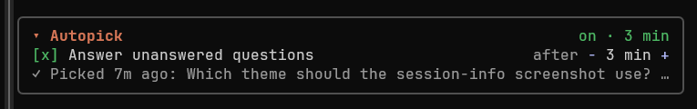

On the row of a waiting question:

- **Pick now** answers with the recommended option at once. The note tells Claude that you took the recommended option without going through the others.
- **Cancel** stops the countdown of that question. The row stays, dim, until you answer.

Claude marks the option it recommends by putting it first and ending its label with `(Recommended)`, or with that word in the language of the question. Autopick takes the first option only when it carries that mark and no other option does. It knows the word in English, Portuguese, Spanish, Turkish, German, French, Italian, Dutch, Polish, Russian, Chinese, Japanese and Korean, and full-width parentheses count too. Three kinds of questions always wait for you, and their row says `No recommended option: the question waits for you.`:

- A question whose first option has no mark.
- A question where a second option has the mark too.
- A question that takes several answers (`multiSelect`).

When a call holds several questions, all of them need a recommended option, or the whole call waits.

While the switch is on, a short section at the end of the system prompt tells Claude the rule before it asks: a question you leave unanswered for the wait gets the option it marked `(Recommended)`, by your standing instruction. The section asks Claude to mark an option only when it can carry it out without you, and to mark none when the step needs your own approval: a change that cannot be undone, a push, a deploy, a message to other people, or a gate that an instruction reserves for you. Such a question has no recommended option, so it waits for you. The section is there only while the switch is on, ask-autopick is not loaded and the request offers the `AskUserQuestion` tool; it adds about 100 tokens to each request.

> [!NOTE]
> Before the section, the note called a pick "a default, not your decision", and Claude often refused to act on it and left the question open. The note now says who set the rule. Claude can still refuse at a gate that an instruction reserves for you, such as the approval step of an SDD flow; for those, run the flow in its own autonomous mode.

The switch and the wait are kept in the mod's store, so they stay across sessions and every open session uses the same values. The switch starts off, and the wait starts at 10 minutes. The `−` and `+` buttons step through 1, 2, 3, 5, 10, 15, 20, 30, 45, 60, 90 and 120 minutes. Turning the switch off stops every countdown that runs. A change of the wait applies to the next question.

> [!NOTE]
> **ask-autopick.** The [ask-autopick](https://github.com/KilimcininKorOglu/claude-code-mods/tree/main/plugins/ask-autopick) mod does the same work. When both answer the same question, the result is not defined, so autopick here stands aside while that mod is loaded: it looks for the `/ask-autopick` command in the session's command list. The section then shows `⚠ The ask-autopick mod is loaded and answers questions too`, and the switch does not turn on until you disable ask-autopick.

> [!CAUTION]
> Autopick answers questions for you: whatever the recommended option does, it is picked. Leave the switch off when a question can lead to a change you must approve. Set `showAutopick` to `false` to remove the section and the `/autopick` command.

## 🧠 What the Skills section shows

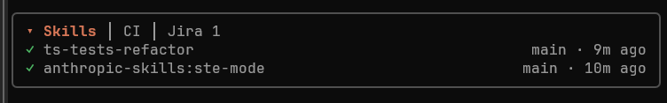

Each skill the conversation loaded, newest first: by the Skill tool (Claude's own choice, or a subagent's) or by a slash command you typed. The row shows the agent that loaded it, `main` for the main conversation, and how long ago.

A skill has no end of its own: its text stays in the conversation. The section shows a skill as active (`⟳`) until the turn of the agent that loaded it ends, then as done (`✓`). The section draws the last 6 skills. `/clear` empties it.

## 🚦 What the CI section shows

The section follows the GitHub Actions runs that the session started through a shell command:

| Command | Runs it follows |
| --- | --- |
| `git push` | The runs of the commit at `HEAD`, found with `gh run list --commit` for 2 minutes after the push |
| `gh pr create` | The same, for the commit at `HEAD` |
| `gh workflow run` | The run whose URL the command printed; with an older `gh` that prints none, the dispatched runs created after the command |
| `gh run rerun <id>` | That run |

The section follows the runs in the repository the command used. A `-R owner/name` or `--repo owner/name` flag, or the run URL the command printed, names the repository for `gh`. A command that runs in another folder, after `cd <dir> &&` or with `git -C <dir>`, reads the commit there and asks `gh` from there; a Git Bash path such as `/d/work/app` works on Windows. When the mod cannot resolve the folder (`cd ~/app`, `cd $APP`, `cd -`), or the folder holds no Git repository, the section starts no watch rather than follow the runs of the wrong repository.

Each run shows its workflow, branch, commit and time, a row of its jobs and an `↗ Open on GitHub` button that opens the run in your browser. While a run is open the section asks GitHub every 15 seconds with `gh run view`; when a run ends it raises a native notification with the result. The header shows `⟳ running` while a run is open, else the worst result. A new push replaces the runs of the previous one.

> [!IMPORTANT]
> The section needs the [GitHub CLI](https://cli.github.com/) on the `PATH`, logged in with `gh auth login`; the mod never reads a token. When `gh` is missing or fails, the section shows its message and stops asking.

A `/clear` or a `/resume` ends the watch: the runs belong to the conversation that started them.

## 🎫 What the Jira section shows

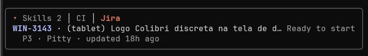

The issues the chat mentions, the last one first, read with `getJiraIssue` on the Atlassian MCP server you connected (for example the Atlassian plugin). The mod calls the server with Claude Code's own connection, so it never reads a credential. Without a connected server that serves `getJiraIssue`, the section stays hidden.

The section finds an issue key in three places:

- Your prompt and Claude's answer, when `jiraKeyPattern` matches. Set it to your keys, for example `WIN-\d+|ABC-\d+`. An empty pattern finds nothing, so `UTF-8` or `SHA-256` never reads as an issue.
- A `/browse/KEY-123` link, with or without the pattern.
- Claude's own `getJiraIssue` calls. The section takes the issue from Claude's answer and makes no call of its own.

A key from your prompt or Claude's answer is read by the mod's own call. That call goes through Claude Code's permission check like a tool call of Claude's, so in the default or auto mode it can be refused. Auto mode refuses it every time: its classifier judges only the calls a request of Claude's asked for, and gives no verdict for the mod's own. The row then says which tool to allow, and the transcript gets the whole message. Under it, while no allow rule covers the tool, two buttons help: `Allow reads` puts a request for the rule in the prompt, after any draft, for you to send, and `Copy rule` copies the tool name. The mod never writes your settings itself: the API has no call to add a permission rule, and a plugin that granted itself one would skip your approval. A read Claude made itself is not replaced by a refusal that comes later.

> [!TIP]
> To let the mod read issues, allow the two tools it calls in your settings:
>
> ```json
> {
>   "permissions": {
>     "allow": [
>       "mcp__plugin_atlassian_atlassian__getJiraIssue",
>       "mcp__plugin_atlassian_atlassian__getAccessibleAtlassianResources"
>     ]
>   }
> }
> ```

With `jiraSite` set, the mod never calls `getAccessibleAtlassianResources`. The tool names follow the server you connected; `/mcp` lists them.

Each issue shows its key, summary, status, priority, assignee and when it was last updated. Pressing the key opens the issue in your browser. A key read in the last 5 minutes is not read again. The section draws the last 3 issues. `jiraSite` names your site (`https://company.atlassian.net`); left empty, the mod asks the server for the first Jira site your account reaches. `/clear` empties the section.

## 🧱 Arrange the cards

Layout mode changes the same settings that `/config` changes, so the order and the hidden cards stay for the next sessions.

- **`↑` and `↓`** move the card one place up or down. The mod writes the new order to `sectionOrder`. A tab group moves as one card, and a hidden section keeps its place in the order.
- **`✕`** sets the `show*` setting of the section to `false`, for example `showGit`. In a tab group, `✕` hides the tab that is open. The effect is the same as in `/config`: `showTodos` off also removes the `todo_write` tool and its prompt section, and `showAutopick` off also removes the `/autopick` command.
- **`Sections`**, above the footer, lists every section in the order of the pane with `[x]` (shown) or `[ ]` (hidden). Press a name to show or hide that section. Layout mode scrolls the pane to its end, so the list shows when the mode turns on.
- **`Hidden:`** at the bottom of the pane lists the sections whose `show*` setting is `false`. Press a name to set it back to `true`. Layout mode replaces this list with `Sections`.

`/config` does not list the thirteen `show*` settings: the `Sections` list sets them. They stay settings, so `/config session-info.showGit=false` and your settings file still change them.

After each change, Claude Code loads the mod again with the new settings, so the pane draws once more. The settings stay. A load stops the timers of the mod, so the layout does not change while an autopick countdown runs: the mod shows a toast instead. Cancel the countdown or let it end first. When a managed policy owns a setting, Claude Code refuses the change and the mod shows the reason in a toast.

## 🔧 Settings

Change these in `/config`, or move and hide the cards in [layout mode](#-arrange-the-cards). The `show*` settings are not rows of `/config`: set them in layout mode or with `/config session-info.<setting>=<value>`.

| Setting | Values | Default |
| --- | --- | --- |
| `session-info.openOnStart` | `true`, `false` | `false` |
| `session-info.showSession` | `true`, `false` | `true` |
| `session-info.cacheTtl` | `auto`, `5m`, `1h`: the prompt cache TTL. `auto` follows the account and the session's requests | `auto` |
| `session-info.cacheGuard` | `true`, `false`: hold a prompt that would write an expired cache again | `true` |
| `session-info.cacheGuardMinTokens` | The context, in tokens, from which the cache guard holds a prompt | `150000` |
| `session-info.keepWarmHours` | How many hours Keep warm runs | `4` |
| `session-info.showLastTurn` | `true`, `false` | `true` |
| `session-info.showTodos` | `true`, `false` | `true` |
| `session-info.todoMinSteps` | A whole number from 1: the steps that call for a task list | `3` |
| `session-info.todoInstruction` | Your own text for the prompt section that asks for the task list. Empty uses the built-in text | empty |
| `session-info.showAutopick` | `true`, `false`. The switch and the wait are set in the section, not here | `true` |
| `session-info.showSkills` | `true`, `false` | `true` |
| `session-info.showCi` | `true`, `false` | `true` |
| `session-info.showJira` | `true`, `false` | `true` |
| `session-info.jiraKeyPattern` | A regular expression for your issue keys, for example `WIN-\d+\|ABC-\d+` | empty |
| `session-info.jiraSite` | Your Jira site URL, for example `https://company.atlassian.net`, or its cloud id. Empty uses the first site your account reaches | empty |
| `session-info.showUsage` | `true`, `false` | `true` |
| `session-info.showAgents` | `true`, `false` | `true` |
| `session-info.showBackground` | `true`, `false` | `true` |
| `session-info.showChecks` | `true`, `false` | `true` |
| `session-info.suggestFix` | `true`, `false`: propose a prompt that fixes a failed build or test run after the turn | `true` |
| `session-info.showGit` | `true`, `false` | `true` |
| `session-info.gitClient` | A command, for example `lazygit`, `gitui` or `tig`. Put a path with spaces in double quotes. Empty turns it off | `lazygit` |
| `session-info.showChanges` | `true`, `false` | `true` |
| `session-info.tabGroups` | Sections that share one card as tabs: groups split by commas, sections by `+`, for example `changes+git, ci+jira+skills`. Names: `session`, `lastTurn`, `todos`, `autopick`, `skills`, `ci`, `jira`, `usage`, `agents`, `background`, `checks`, `git`, `changes`. The first section of a group is the tab it opens on. Empty gives each section its own card | `changes+git` |
| `session-info.sectionOrder` | The sections in order, top to bottom, split by commas, for example `changes, git, session`. Same names as `tabGroups`. The sections not named follow in the default order; a tab group card sits where its first shown section sits. Empty keeps the default order | `session, lastTurn, todos, autopick, skills, ci, jira, usage, agents, background, checks, git, changes` |
| `session-info.alerts` | `true`, `false` | `true` |
| `session-info.viewer` | `auto`, `git`, `vscode`, `inline` | `auto` |
| `session-info.editor` | `auto`, `vscode`, `system` | `auto` |
| `session-info.paneBackground` | A color for the body of the pane in the terminal: hex such as `#2e3440`, or a color name. Empty keeps the color Claude Code draws. The frame and the close row keep Claude Code's color | empty |
| `session-info.paneTitle` | A name for this pane, up to 40 characters, for example `Personal` or `Work`, to tell accounts apart. It becomes the pane's tab title and a one-row rule at the top of the pane, `─── Title ───`. Empty keeps the title `Session info` and draws no rule | empty |
| `session-info.paneTitleColor` | The color of the rule and the title: hex such as `#ff8700`, a color name or a theme key such as `success`. Needs a pane title. Empty keeps the default text color | empty |
| `session-info.paneTitleAlign` | `left`, `center`, `right`: where the title sits on its rule. Needs a pane title | `left` |
| `session-info.icons` | `unicode`, `nerd` (needs a [Nerd Font](https://www.nerdfonts.com/)), `emoji` | `unicode` |
| `session-info.buildPattern` | A case-insensitive regular expression matched against each command segment, for example `^make( \|$)` | empty |
| `session-info.testPattern` | The same, for test runs, for example `^just test\|^task test` | empty |

With `openOnStart`, Claude Code draws the pane at session start only on a terminal of 144 columns or more, or 110 once you have opened the pane and not closed it by hand. On a narrower terminal the pane waits until you widen the terminal or run `/session-info`. A `-p` run does not open it. A reload of the mod opens it again.

Claude Code draws a pane's tab title only while more than one pane is open, so `paneTitle` also draws its own rule at the top of the pane. The mod cannot read which account is logged in, because the supported API does not expose it: the name is one you set. If you keep one settings folder per account, for example with `CLAUDE_CONFIG_DIR`, each account keeps its own title and color.

## 🔍 How changes are detected

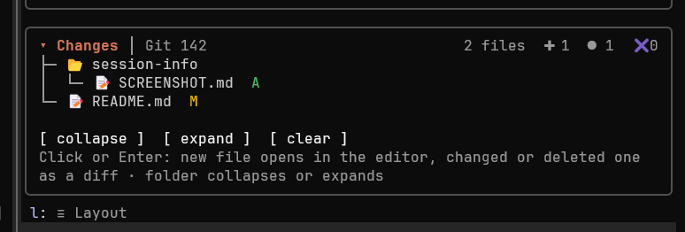

| Tool | Source |
| --- | --- |
| Write, Edit, NotebookEdit | The tool's own result, which carries the original content |
| Bash | The per-file diff Claude Code records for the command, including created and deleted files |
| PowerShell | `git status` before and after the command |

After every shell command, the mod also checks that each listed file still exists, so a file that was deleted shows as deleted. A file created and then deleted in the same session leaves the list.

## 🚧 Limitations

- **PowerShell commands:** a file that was already modified before the command and is modified again is not detected. Outside a git repository, only deletions of files already in the list are detected.
- **Mouse clicks** work in the fullscreen terminal. Elsewhere, use the keyboard.
- **Tree scrolling** places each list in the pane from the rows the sections above it are expected to take, and the wheel finds a list within 2 rows of where the mod placed it. When the pane is taller than its window, a wheel just outside that margin scrolls the pane instead of the list.
- **The diff viewer** runs as a child of the mod, so it closes when the mod reloads. On Linux the terminal window of the Git client does too.
- **Binary files** are not handled. The snapshot stores text only.
- **Checks of background commands** end when the task's notification reaches the session, not when the command ends. A newer run of the same kind replaces the row first, and the notification of the older run changes nothing. When the task's output file is gone, the row shows the status alone.
- **Check details** depend on the tool's output format. When a format is not recognized, the row shows the status and, for a failure, the last lines of the output. `rtk dotnet test` on a Microsoft.Testing.Platform project prints no counts when it passes, so the row says `passed`.
- **Background tasks that end with no notification** are found at the end of a turn through the `classic.Stop` event, which Claude Code does not send to a plugin you install yourself where an organization manages Claude Code through managed settings. There a task stopped with `TaskStop` still shows `stopped`, but a task stopped in another way stays `running` until `/clear`.
- **Auto-continue** needs the `classic.Stop` event, which Claude Code does not send to a plugin you install yourself where an organization manages Claude Code through managed settings. There the switch changes nothing, unless the organization lists the mod in its managed settings.
- **Auto-continue** reads a question only by its question mark. A reply that waits for you without one, such as `Tell me when you are ready.`, gets a continue; Claude is told to stop and ask before a step that needs you, and the limit of 5 in a row and the progress check bound the rest.
- **Build guard** sees only what git sees: a change in an ignored file, outside the repository or in an environment variable does not change the fingerprint. The 30-minute limit and `# rerun` cover those cases.
- **Autopick** depends on Claude Code closing the question when the mod answers the call first. This was measured on Claude Code 2.1.296, for a pick after the wait and for Pick now pressed in the pane while the question was open; the mod API does not document it. Waits longer than 1 minute were not measured live. A question in a language whose word for "recommended" is not on the list waits for you. A copy of ask-autopick loaded under another name is not detected.
- **Cache TTL** is not in the mod API, except when you switch the model. The `auto` TTL is a guess from the account until a request shows it. A request after 5.5 to 60 idle minutes corrects it, so the first cold prompt after a wrong guess can be held too early or not at all. Set `cacheTtl` when you know your TTL.
- **Cache age after a resume** comes only from a `classic.SessionStart` event with `seconds_since_last_response`, which Claude Code documents for a resume or a fork; this was not measured live. A `/resume` inside a running session raises no such event for a mod (measured on 2.1.296), so the cache row and the guard wait for the next reply.
- **Model switch and resume** need the `classic.PostModelSwitch` and `classic.SessionStart` events, which Claude Code does not send to a plugin you install yourself where an organization manages Claude Code. There the TTL comes from the account and the requests only.
- **Cache guard and topic-guard** both hold a prompt at the same Enter. With both mods on, a prompt can be held twice in a row, once by each band.
- **Compact** in the cache guard's band runs `/compact` as you would type it. That the prompt box keeps the held prompt through it was not measured live. If the box is empty after it, type the prompt again.
- **Keep warm** costs a cache read of the whole context per ping, added to the session's cost. A turn that runs while it pings is not interrupted.
- **Usage** shows only the windows Claude Code exposes to mods. The per-model weekly windows and the `~N tok/turn` total that `/usage` prints come from an endpoint mods cannot reach without your OAuth token, so they are left out.

## 🔨 Development

```text
claude plugin validate .
claude plugin test .
claude --plugin-dir .
```

<details>
<summary>🗂 Source files</summary>

| File | Role |
| --- | --- |
| `hooks/register.tsx` | The commands, the `tool.call`, `tool.check`, `prompt.submit`, `prompt.suggest`, `turn.complete`, `agent.spawn` and `session.compact` hooks, the refresh and keep-warm timers, the pane and the cache guard's band |
| `hooks/cards.tsx` | Framed cards, the tiles row and how the tiles wrap |
| `hooks/usage.ts` | Window labels, bars and reset countdowns |
| `hooks/session.ts` | Token, duration, cost and turn formatting |
| `hooks/context.ts` | The stacked context bar: slices, cell widths, legend lines |
| `hooks/cache.ts` | The prompt cache: the TTL it finds from the requests, the status and its row, when the guard holds a prompt, when keep warm pings and what a ping found, and the move to a new session |
| `hooks/autopick.ts` | Which option autopick picks, its settings, the minute steps, the countdown and its texts |
| `hooks/agents.ts` | Agent ordering, nesting and status glyphs |
| `hooks/alerts.ts` | Which thresholds a measurement crosses, once per window |
| `hooks/checks.ts` | Which commands are builds or test runs, the record of each run, its rows and the fix prompt |
| `hooks/guard.ts` | The build guard: the working-tree fingerprint, the runs it keeps and reuses, and the text Claude reads for a skip |
| `hooks/background.ts` | The list of background commands: starting one from a shell call's result, ending it from its notification, a `TaskStop` call or its absence from the in-flight list at a stop, ordering, texts and status glyphs |
| `hooks/detail.ts` | The detail view's text: joins the parts and cuts a text past its limit |
| `hooks/tasks.ts` | Reads a background task's end from its notification and finishes the check that waits on it |
| `hooks/parse.ts` | Reads error lines, error counts, test counts and failed test names from build and test output |
| `hooks/track.ts` | Turns tool results into created, modified or deleted entries |
| `hooks/git.ts` | `git status`, `HEAD` content and snapshots |
| `hooks/repo.ts` | Reads and parses the repository state for the Git section, and its row texts |
| `hooks/client.ts` | Opens the Git client in a new terminal window |
| `hooks/viewer.ts` | Opens a change: the editor for new files, the diff viewer for the rest |
| `hooks/tree.ts` | Builds and flattens the tree |
| `hooks/icons.ts` | Icon sets and status colors |
| `hooks/patch.ts` | Reverses hunks to recover a file's previous content |
| `hooks/host.ts` | The engine calls the helper modules use |
| `types/index.d.ts` | The `$.state` contract |

</details>

## 🙏 Credits

The stacked context bar follows the design of [context-bar](https://github.com/hamzafer/claude-code-mods/tree/main/mods/context-bar) by Hamza Zafar (MIT).

The Autopick section follows [ask-autopick](https://github.com/KilimcininKorOglu/claude-code-mods/tree/main/plugins/ask-autopick) by Kerem Gok (MIT): the rules that find the recommended option, its list of words for "recommended", and the note that tells Claude the pick was not your choice.

## 📄 License

[MIT](../LICENSE)
