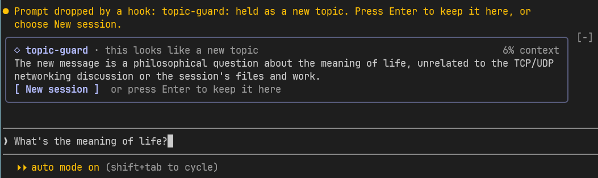

<h1 align="center">🧭 topic-guard</h1>

<p align="center">
  A Claude Code mod that keeps one topic per session: a message that starts a separate topic can go to a new session before it enters this one.
</p>

<p align="center">
  
  <a href="../LICENSE"></a>
  
</p>

<p align="center">
  <a href="#-install">Install</a> ·
  <a href="#-use">Use</a> ·
  <a href="#-settings">Settings</a> ·
  <a href="#-the-jev-judge">The Jev judge</a> ·
  <a href="#-limitations">Limitations</a> ·
  <a href="#-development">Development</a>
</p>

## ✨ What it does

A session that mixes topics carries context the next message does not need. This mod checks each message you type before it enters the session:

1. 🔎 **Judge:** a small model (Haiku by default) reads the end of the conversation and your new message, and decides `related` or `new-topic`. When it is not sure, it answers `related`. With the `judge` setting on `jev`, the [Jev MCP](#-the-jev-judge) judges instead, and the model stays as its fallback.
2. ✋ **Hold:** a `new-topic` message does not enter the session, and Claude Code puts it back in the prompt box. A band above the prompt shows the reason, with a **New session** button.
3. 🔁 **Move or keep:** **New session** runs `/clear` and leaves your message in the prompt box of the new session: press Enter to send it there. Press Enter in this session instead to keep the message here.

<p align="center">
  
</p>

The band holds three lines in a quiet rounded frame, which lights up under the pointer:

- **Title:** `◇ topic-guard`, then `this looks like a new topic`, and on the right how full the context window is.
- **Reason:** the judging model's reason, in one sentence.
- **Action:** the **New session** button and the hint `or press Enter to keep it here`. While the mod clears the session, the frame reads `◌ topic-guard · clearing the session…`.

The mod never sends your message for you, so it enters as your own prompt, with its images and `@` mentions. A `related` message enters at once, as typed. The new session gets no handoff: a separate topic needs nothing from this conversation. To carry the work itself to a fresh session, use a tool made for it, such as ContextBrake.

The mod pins a **status line** under the prompt, so you can see that it is active and who judges, for example `haiku · related at 45%` or `Jev down, haiku judging · related at 45%`. Claude Code draws it as a yellow notice headed by the mod's name, and the mod cannot change that. It reads `off` when `analyze` is off, and `showStatus` turns it off.

The mod stands alone: it needs no other mod, skill or tool.

## 🚀 Install

At the Claude Code prompt:

```text
/plugin install topic-guard --marketplace dougcunha/claude-mods
```

Answer `y` to add the marketplace and choose a scope. If you already added the marketplace:

```text
/plugin install topic-guard@claude-mods
```

## 🎮 Use

| Action | How |
| --- | --- |
| Send a held message to a new session | Press **New session**, then Enter in the new session |
| Send a held message to this session | Press Enter again. The mod judges again only when the context grows by 10 more points |
| Drop a held message | Change or replace the text in the prompt box and send it. The mod judges the new text |

While the mod clears the session, the band says so. When the clear fails, the session stays as it was, the message stays in the prompt box, and a toast says so.

The mod judges only a prompt you type at an idle session. It lets these enter without a judgment:

- slash commands, and prompts from a plugin, Remote Control, a background task, a schedule or another session;
- a prompt typed while a turn runs, which belongs to that turn;
- a prompt to a session where the model has not answered yet, which has no topic: a fresh session, or one that holds only local commands such as `/clear` and `/reload-plugins`;
- every prompt while the context window is less than 20% full. Until the first answer of a fresh or just compacted session, the engine reports no figure, and the mod counts the context as 0%.

## 🔧 Settings

Set them in `/config`, under the mod's name.

| Option | Default | What it does |
| --- | --- | --- |
| `analyze` | `true` | Judge each prompt and hold a new topic. Off lets every prompt enter. |
| `judge` | `model` | Who judges a prompt: `model` (the model below) or `jev` (the Jev MCP, with the model as its fallback). See [The Jev judge](#-the-jev-judge). |
| `model` | `haiku` | The model that judges a prompt: an alias or a full model id. The call goes through the session's own client. With `judge` on `jev`, it judges only when Jev cannot. |
| `minContextPercent` | `20` | Judge a prompt only when the context window is at least this full. `0` judges every prompt. |
| `recheckStep` | `10` | After you keep a held message here, judge again only when the context grew by this many points. A context that drops below that point, as after a compact, is judged again at once. |
| `showStatus` | `true` | Pin the status line under the prompt: who judges (the model, or Jev, and whether Jev is down) and the last thing the mod did (`held a new topic at 62%`, `related at 45%`, `kept here at 62%`, `skipped at 12%, judging from 20%`, `no judgment at 0%`). It never holds prompt or reply text. Off pins nothing. |
| `debug` | `false` | Write one line per judgment and choice to `<temp>/claude-topic-guard/<session id>/debug.log`: the time, the session id, the context percent and the outcome (`judge: related at 45%`, `judge: none at 0%`, `judge: related at 45% (Jev MCP is not connected)`, `keep here at 7%`, `new session: done`). It never holds prompt or reply text. `<temp>` is `TEMP`, else `TMPDIR`, else `/tmp`. |

## 🧪 The Jev judge

Set `judge` to `jev` to have the Jev MCP decide instead of the model. [Jev](https://docs.typesafe.ai) is TypeSafe's judging model; it returns calibrated probabilities and usually answers in under a second.

- **What it needs:** a connected MCP server with a `jev_classify` tool, such as the community package [`@jkudish/jev-mcp`](https://github.com/jkudish/jev-mcp) (`claude mcp add jev -- npx -y @jkudish/jev-mcp`) and a provider key such as `TYPESAFE_API_KEY`. It is not an official TypeSafe package, and the mod does not install it. The mod finds the server by the tool's name, whatever the server is called.
- **What it sends:** the same excerpt the model reads (the end of the conversation, up to 12,000 characters) and your prompt (up to 2,000 characters), to the MCP server and from there to its provider. With `judge` on `model`, nothing leaves the session's own client.
- **When Jev decides:** when it settles the answer itself. It then shows `Jev is 96% sure it needs nothing from this conversation.` as the reason.
- **When the model decides:** when Jev is not connected, fails, is blocked by the permission mode, reports an error, sends an answer the mod cannot read, does not answer in 4 seconds, or leaves the answer to review (low confidence). For all but the last, a toast says so once: `topic-guard: the Jev MCP failed or did not answer in time. Judging with haiku instead.` It warns again only after Jev has judged and then failed again. A review answer is Jev being unsure, not an outage, and warns of nothing.
- **Auto mode and other permission modes:** the Jev call sends the conversation to a third party, so a mode that decides for you, such as auto mode, may refuse an MCP tool you have not allowed. When the call fails and the permission check says the tool would not run unasked (`ask` or `deny`), the toast reads `topic-guard: the Jev MCP was blocked by the permission mode. Judging with haiku instead.` and a notice above the prompt offers two ways out:
  - **Judge with haiku** (or the model you set) sets `judge` to `model`, as `/config` would.
  - **Allow the tool** yourself: add `mcp__jev__jev_classify` to `permissions.allow` in your settings (the notice names the exact tool, which follows the server's name). With the rule, the call runs in every mode, so it is your decision to let the conversation excerpt go to Jev's provider; on an organization's account, check that its data policy allows it. The mod never edits your settings.
  - **Dismiss** hides the notice. It comes back only after Jev has judged and then been blocked again.
  - The check is a diagnosis made after a failure, so a mode that lets the call run costs nothing, and a timeout is never reported as a block. It cannot tell auto mode from a failure of another kind that happens while the tool is not allowed, so the notice can be wrong about the cause; the allow rule and the switch to the model are safe either way.

## 🚧 Limitations

- **Blocked Jev, found by asking:** the mod does not read the permission mode; it asks the permission check about the Jev tool after a failed call. If a later Claude Code version lets the call through without that check, the notice never shows and a failure reads as a plain one.
- **Wait:** a judged prompt waits for the judging model, usually 1 to 3 seconds and at most 8. When the model fails or does not answer in time, the prompt enters as typed. With the Jev judge the wait is usually under a second; when Jev fails, the prompt waits for Jev's limit of 4 seconds and then for the model, so at most 12.
- **Cost:** each judged prompt is one call to the judging model, with up to 12,000 characters of the conversation and 4,000 of the new message.
- **Wrong judgments:** the model can take a short follow-up for a new topic. Press Enter again to send it on, and the mod stops asking until the context grows.
- **The new session:** the prompt box keeps its draft through `/clear`. After `/clear` the engine reports the old session id for about a second, so the mod waits up to 3 seconds for the new id, then puts the message back in the box only if the box is empty. An image pasted in a box that `/clear` emptied does not come back.
- **The status line** is plain text, one line, drawn at the session start and after each judgment; the engine gives a mod no color for it. The text it shows after a `/clear` is the one from before, until the next judgment.
- **The band's state** lives in the session: `/clear`, a resume and a restart reset it. After a `/clear` the engine no longer redraws the band when the state changes, so the mod asks for a redraw after each change.
- **No automatic move:** the mod never clears a session without your press.

## 🔨 Development

```text
claude plugin validate .
claude plugin test .
claude --plugin-dir .
```

Run the manual check in a session you can lose: **New session** clears it.

<details>
<summary>🗂 Source files</summary>

| File | Role |
| --- | --- |
| `hooks/register.tsx` | The `prompt.submit` hook and the band |
| `hooks/judge.ts` | Which prompts to judge, the judging prompt, the transcript excerpt, the reply parser and the Jev-then-model fallback |
| `hooks/status.ts` | The text of the status line |
| `hooks/jev.ts` | The `jev_classify` request, the reader of its result and the server names |
| `hooks/session.ts` | The move to a new session and the debug log path |
| `hooks/host.ts` | The engine calls the helper modules use |
| `types/index.d.ts` | The `$.state` contract |

</details>

## 📄 License

[MIT](../LICENSE)
